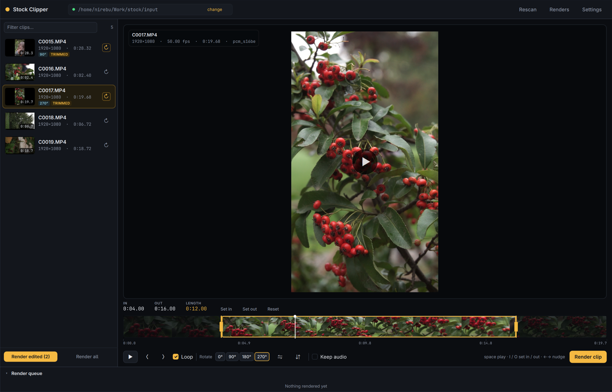
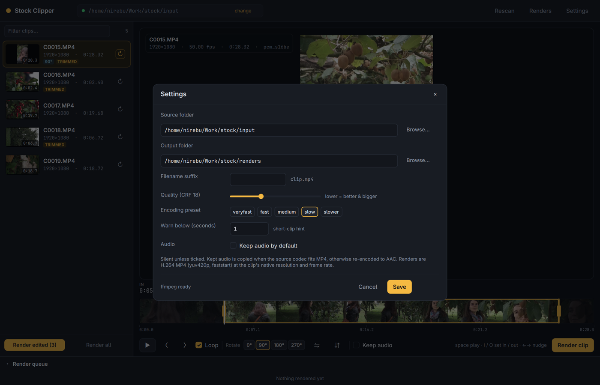

<p align="center">
  
</p>

<h1 align="center">Stock Clipper</h1>

<p align="center"><strong>Footage in. Stock clips out.</strong><br>A local app for turning camera footage into individual stock videos.</p>

<p align="center">
  <a href="#build"><strong>Build</strong></a> ·
  <a href="#cut-your-first-clip">First clip</a> ·
  <a href="#what-a-render-does">Rendering</a> ·
  <a href="#keys">Keys</a> ·
  <a href="#development">Develop</a>
</p>

<p align="center">
  <a href="CMakeLists.txt"></a>
  <a href="CMakeLists.txt"></a>
  <a href="#known-limitations"></a>
</p>

Stock Clipper takes a folder of camera clips and gives you finished stock
videos: trim the part worth keeping, turn a sideways shot upright, flip it if
the composition wants it, render one finished file per clip — H.264 MP4 by
default, or ProRes/DNxHR MOV for interchange. It is a native Qt 6 / QML
application — one binary, no browser engine, no proxy files — that runs
`ffmpeg` and `ffprobe` from your `PATH`. Renders keep the clip's native
resolution and frame rate; nothing is scaled, letterboxed or re-timed.

**ffmpeg is not bundled.** `ffmpeg` and `ffprobe` must be on `PATH`. Clips are
read from a source folder (default `./input`) and written to an output folder
(default `./renders`), both chosen in Settings.



[Features](#your-library-one-clip-at-a-time) · [Build](#build) · [First clip](#cut-your-first-clip) · [Rendering](#what-a-render-does) · [Files](#where-your-work-lives) · [Keys](#keys)

## Your library, one clip at a time

| Feature | What you can do |
|---|---|
| **Library** | Point it at a folder; clips up to three levels deep appear with duration, resolution, frame rate and audio codec. Rescan re-walks the folder when you add footage. |
| **Trimming** | Drag the in and out handles on the filmstrip, set them at the playhead with `I` and `O`, nudge by 0.1 s, or type exact times. Loop replays the selection while you decide. |
| **Orientation** | Rotate in 90° steps and flip horizontally or vertically. The preview shows the result immediately; flips apply in output space, after rotation. |
| **Preview** | Plays the original file through the platform decoder, so seeking is instant and no proxy is written. A paused player is primed with a single frame, so the stage is never left black. |
| **Rendering** | One file per clip: H.264 High MP4 by default, or ProRes 422 HQ / DNxHR HQX MOV. Native resolution and frame rate, rotation and flips applied, everything else untouched. |
| **Audio** | Silent by default. Tick **Keep audio** per clip or set it as the default; codecs the container accepts are stream-copied (PCM is fine in MOV), the rest are re-encoded to AAC. |
| **Queue** | **Render clip** renders the selection, **Render edited** every trimmed clip, **Render all** the whole library. Jobs run one at a time, with progress, speed, the ffmpeg error when one fails, cancel and retry. |
| **Your work** | Cuts and orientation are saved about a quarter of a second after they change and restored on restart. A render older than its cut says `re-render` instead of pretending to be current. |
| **Settings** | Source and output folders with the native system folder picker, output format, CRF, encoding preset, filename suffix, short-clip warning, and the default audio choice. |

## Build

| Platform | Installation |
|---|---|
| **Arch Linux** | `sudo pacman -S qt6-base qt6-declarative qt6-multimedia-ffmpeg` |
| **Other Linux** | Qt 6.5+ with Core, Gui, Quick and Multimedia, the **FFmpeg** multimedia backend, and `ffmpeg` on `PATH`. |
| **From source** | `cmake -S . -B build -G Ninja && cmake --build build && ./build/stock-clipper` |

```sh
cmake -S . -B build -G Ninja
cmake --build build
./build/stock-clipper
```

Qt's FFmpeg multimedia backend is the one to build against. The GStreamer
backend is not what this app is tested with, and the preview is the whole point.

## Cut your first clip

1. Put the footage in the source folder and press **Rescan**. Each clip lists
   its duration, size and frame rate as soon as it has been probed.
2. Select a clip, then drag the handles on the filmstrip or press `I` and `O` at
   the playhead. Press `Space` to watch the selection loop. Use `Rotate` for a
   shot that was filmed sideways.
3. Press **Render clip**. The file appears in the output folder; **Render
   edited** renders every clip you have trimmed, **Render all** the whole
   library.

`in` and `out` are times in the source clip, not in the trimmed result, and the
timeline is laid out against the full duration — so dragging one handle never
moves the other. `out` is exclusive, the trimmed length is `out - in`, and a cut
needs at least 0.05 s. Edits are keyed by absolute path, so footage that moves
or is renamed loses its trim.

## What a render does

Only orientation is applied: rotation first, then flips, then a
`scale=trunc(iw/2)*2:trunc(ih/2)*2` and `setsar=1` to keep `yuv420p` happy on odd
dimensions. Output keeps the clip's native resolution and frame rate. No
scaling, no frame-rate conversion, no letterboxing, no colour management — what
stock sites expect, and the closest thing to lossless apart from the encode
itself.

- The output format is global: H.264 High (`.mp4`) by default, or ProRes 422 HQ /
  DNxHR HQX (10-bit 4:2:2, `.mov`). The last two ignore CRF and preset and write
  much larger files.
- `-ss` goes before `-i` and `-t <out - in>` after it, so the cut is frame
  accurate while still cheap to seek.
- Only the first video and audio streams are mapped. Sony and GoPro files carry
  extra timed-metadata streams that no player or stock site wants.
- Metadata is dropped and the file is written with `+faststart`.
- `-level` is left to x264. Pinning it breaks 4K input.

Audio follows the **Keep audio** choice:

| Source | Result |
|---|---|
| AAC, MP3, AC3/E-AC3, ALAC | Stream-copied, with `-shortest` so a copied packet cannot run past the video. |
| PCM in a `.mov` render | Stream-copied; MOV carries it fine. |
| Anything else, such as Sony's `pcm_s16be` in an MP4 | Re-encoded to AAC 192 kbit/s at 48 kHz. PCM in MP4 is rejected by players and stock sites. |
| Stripped, or a silent clip | No audio track at all. |

A file whose pixels are already upright is not rotated twice: the probe reports
display dimensions separately from coded ones, the stage is sized from those,
and the file's own rotation flag is left alone. Manual rotation is layered on
top of it.

## Where your work lives

State is per user, never in the checkout:

| What | Where |
|---|---|
| Settings and cuts | `~/.local/share/stock-clipper/` (`settings.json`, `edits.json`) |
| Probe cache, thumbnails, filmstrips | `~/.cache/stock-clipper/` |

Both are plain JSON, and unknown fields are ignored on load. On first launch the
app imports `./data/settings.json` and `./data/edits.json` from the directory it
was started in, so a fresh state directory inherits existing trims and folders.
Set `STOCK_HOME=/some/dir` to use a throwaway state directory (`dir/data`,
`dir/.cache`).



Settings holds the two folders and the encode: output format, CRF, preset, suffix,
and the short-clip warning. **Save** applies it and rescans the source folder.

## Keys

| Key | Action |
|---|---|
| `Space` | Play or pause the trimmed range |
| `I` / `O` | Set in or out at the playhead |
| `←` / `→` | Step one frame (`Shift`: one second) |
| `[` / `]` | Nudge in or out by 0.1 s (`Shift`: 1 s) |
| `Ctrl+Enter` | Render the current clip |
| `Esc` | Close a dialog |

Clicking the filmstrip seeks. There is no filesystem watcher: **Rescan** is how
new footage appears.

## Guides and help

| You want to… | Read |
|---|---|
| Change the pipeline, the edit model, or the UI | [AGENTS.md](AGENTS.md) |
| Check a render without a screen | [Development](#development) |
| Know what it refuses to do | [Known limitations](#known-limitations) |
| Understand the cut and audio rules | [What a render does](#what-a-render-does) |
| Find where trims and caches are stored | [Where your work lives](#where-your-work-lives) |

## Development

A headless driver is built alongside the app. It scans the library, applies
`in=0.5 out=2.0 rotate=90` to a clip, renders it, and prints the output path:

```sh
cmake --build build --target stock-clipper-selftest
STOCK_HOME=/tmp/sc-test QT_QPA_PLATFORM=offscreen ./build/stock-clipper-selftest
```

Then probe what it wrote and assert the result: duration `out - in`, rotated
dimensions, native frame rate, and the container/codec of the selected format
(`yuv420p` High H.264 with `moov` before `mdat`, or 10-bit 4:2:2 ProRes/DNxHR in
MOV), plus the audio track when it was kept. Set `SC_FORMAT=prores` or
`SC_FORMAT=dnxhr` to exercise the mezzanine formats.

The app takes a few development variables:

| Variable | Effect |
|---|---|
| `SC_DEBUG=1` | Frame, loop and player-state tracing on stderr |
| `SC_SHOT=/tmp/out.png` | Select a clip, seek, grab the window, exit |
| `SC_SHOT_DELAY=ms` | Delay before the grab (default 5000) |
| `SC_CLIP=C0016` | Clip name filter for `SC_SHOT` |
| `SC_FORMAT=prores` | Render format for the selftest (`h264`, `prores`, `dnxhr`) |
| `SC_OPEN=settings` | Open a dialog before grabbing |
| `SC_RENDER=1` | Render the selected clip before grabbing |
| `SC_AUTOPLAY=1` | Start playback before grabbing |

QML warnings are swallowed by Qt's default handler; `main.cpp` installs one that
prints to stderr. Keep it, or load errors are silent.

## Known limitations

- Library scan is depth-3 and polled. Rescan after adding files.
- Edits are keyed by absolute path: moving or renaming footage orphans its
  trim, rotation and render bookkeeping.
- One render at a time, software encoding only — there is no `h264_nvenc` or
  VAAPI path.
- The output format is global: one setting for the whole queue, not per clip.
  No MXF, custom bitrates or ProRes/DNxHR profile pickers.
- Preview audio always follows the source, even when the render strips it. A
  kept track is only audible from the rendered file.
- Rendered-file playback is served from the flat output folder.
- No batch rotation beyond the per-row ⟳ button, and no batch trimming.
- Nothing in the app talks to a network: no accounts, no telemetry, no upload,
  and no updater.

## Acknowledgements

Stock Clipper is built with [Qt 6](https://www.qt.io) and drives
[ffmpeg](https://ffmpeg.org) and ffprobe. It writes plain H.264 MP4s, or
ProRes/DNxHR MOVs, and knows nothing about any stock site's metadata; the videos
are yours to submit wherever you like.

It is an independent project and is not affiliated with Pond5 or any other stock
footage marketplace.
